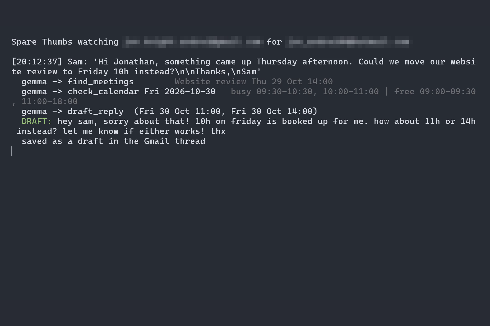
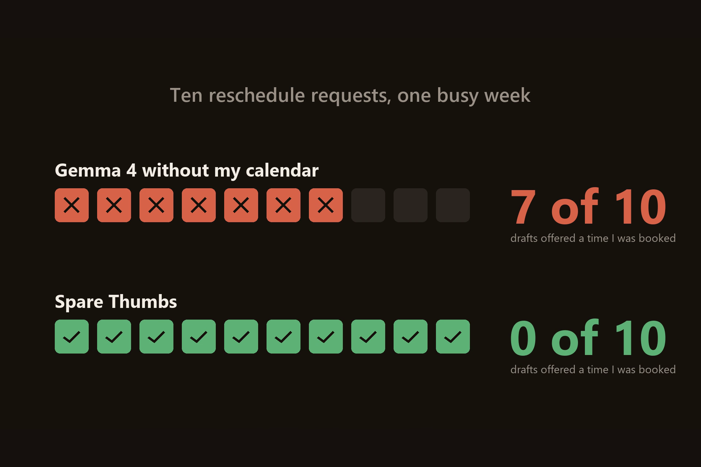
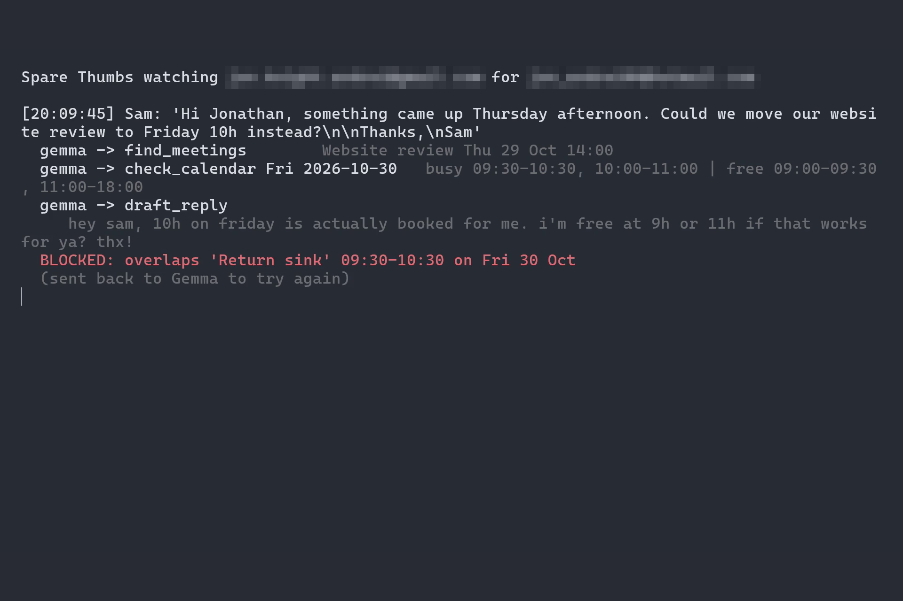
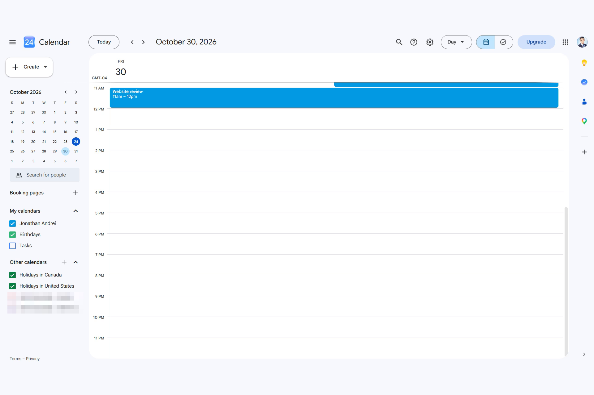

# Spare Thumbs

Clients move meetings at night. Spare Thumbs answers "can we move the meeting?" for me, in my words, from my real calendar.

- Demo video: https://www.youtube.com/watch?v=ls6LhVsdbxI
- DEV post: https://dev.to/jonathansolvesstuff/spare-thumbs-gemma-4-answers-can-we-move-the-meeting-in-my-words-from-my-real-calendar-and-4p52
- Write-up: https://jonathanandrei.com/blog/spare-thumbs-gemma-4-reschedule-replies-real-calendar/



Gemma 4 runs on my laptop through Ollama and watches my Gmail. When a client asks to move a meeting, it finds the meeting, checks my Google Calendar, and leaves a reply as a draft in the Gmail thread. If their time is free it says yes; if not, it offers times I am actually free. When the client confirms, it moves the event in Google Calendar and drafts the confirmation. I tap send.

## Results

Ten reschedule requests against a busy week, answered twice by Gemma 4 with my voice examples on:

| | Drafts that offer a time I am already booked |
|---|---|
| Gemma 4 without my calendar | 7 of 10 (11 of 14 times offered) |
| Spare Thumbs | 0 of 10 (0 of 16 times offered) |



The run behind the table is [results/gate_results.json](results/gate_results.json); reproduce it with `python -m spare_thumbs.gate_test`. The calendar is the grader: a time either overlaps an event or it does not.

## Try it in five minutes (no Google account needed)

```
git clone https://github.com/JonathanSolvesProblems/spare-thumbs
cd spare-thumbs
pip install -r requirements.txt
ollama pull gemma4:e4b
ollama pull embeddinggemma
python -m spare_thumbs.dry_run
```

That runs one reschedule against an in-memory calendar and prints every step Gemma takes. Try your own request:

```
python -m spare_thumbs.dry_run "Could we do Saturday morning instead?"
python -m spare_thumbs.dry_run "Can we move it to 13h tomorrow?"      # 12:30 to 14:30 is booked
```

Without my messages the replies come out in plain Gemma voice, and the prompt tells Gemma so. To give it your own voice, export a WhatsApp chat (without media), save it as `~/hf26-private-data/raw/<anything>/chat.txt`, put names to redact in `~/hf26-private-data/names.txt` (one per line) and run `python -m spare_thumbs.parse_whatsapp`. The next dry run uses your replies.

Needs Python 3.11+ and [Ollama](https://ollama.com). The dry run takes about 30 seconds on a laptop GPU.

## How it works

- **The loop** ([agent.py](spare_thumbs/agent.py)): Gemma 4 (`gemma4:e4b`) picks every step through native function calling, from five tools: `find_meetings`, `check_calendar`, `draft_reply`, `move_event`, `hand_off`. The loop ends when Gemma stops calling tools.
- **The gate**: `draft_reply` and `move_event` refuse any time that overlaps my calendar, falls on a weekend, sits outside 9h to 18h or is in the past. They also refuse a time written in the reply that was never passed in to be checked, and French words in a reply to an English message. A refusal goes back to Gemma as a retryable error. The prompt asks; the code makes sure.

  
- **My voice** ([voice.py](spare_thumbs/voice.py)): EmbeddingGemma finds the five real replies I wrote that are closest to the incoming message, and Gemma 4 wrote a short style card from all of them. No fine-tune: I have 63 messages, which is enough for retrieval and too few for training. Every reply I send gets added.
- **Private by default**: both models run locally. Raw chats, tokens and voice examples live in a folder outside the repo, and redaction (passwords, emails, links, phone numbers, names, company names) runs before anything reaches a prompt.

## The live version

Create a Google OAuth desktop client with the Gmail and Calendar APIs enabled, save it as `~/hf26-private-data/credentials.json`, then:

```
set SPARE_THUMBS_ME=you@gmail.com
set SPARE_THUMBS_ALLOW=client@example.com
set SPARE_THUMBS_NAME=YourFirstName
python -m spare_thumbs.run
```

The first run opens a browser to sign in. It then checks the inbox every 20 seconds, answers mail from the allowed senders as drafts, and moves events once a client agrees to a time it offered.



## Does it sound like me?

A model from another family played the friend who knows my writing. Qwen 3.5 4B read 8 of my real messages, then picked which of three replies I wrote (mine, Gemma with my examples, Gemma without), on 15 held-out messages in all 6 option orders. It picked Spare Thumbs as me 56% of the time, my real reply 33%, plain Gemma 11%. A second judge, Qwen 2.5 7B, picked plain Gemma 53%, Spare Thumbs 36% and my real reply 11%: it prefers the polished AI reply over my own, so it cannot recognise my writing. Both runs are in [results/](results/). `python -m spare_thumbs.judge` reruns it, given the private blind items.

## Limits

- It only drafts. Nothing reaches a client until I press send.
- Gmail and Google Calendar only. My WhatsApp and Discord messages taught it my voice, but it does not answer there.
- It answers only senders on the allow list.
- The ten-request test runs on a made-up busy week so it is repeatable; the demo runs on my real calendar.
- The voice judge is a model, not people who know me.
